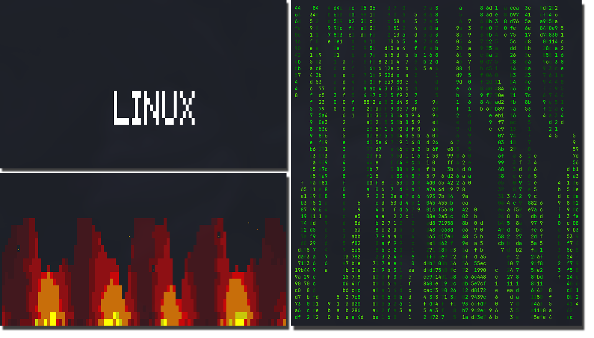

# ltm_list



A collection of useful CLI utilities for everyday tasks.

## Installation

```bash
./install.sh
```

After installation, all programs will be available from any directory.

## Programs

### `dvi` — download video and images

Downloads video from YouTube, VK, Pinterest, TikTok, Instagram, and 1800+ other platforms. If no video is found on the page, it automatically downloads the image.

```bash
dvi <link>                          # best quality
dvi -q audio <link>                 # audio only (MP3)
dvi -q worst <link>                 # worst quality
dvi <link1> <link2>               # multiple links
```

Files are saved in `~/Videos`.

### `dins` — find file in directory

Recursively searches for a file by name, starting from the current folder.

```bash
dins <file_name>                      # Find and show the path
dins                                  # Show welcome page
```

### `gh` — open GitHub in browser

```bash
gh                      # github.com
gh EnotCoder            # user profile
gh EnotCoder ltm_list   # repository
gh EnotCoder/ltm_list   # repository
```

### `snk` — snake

Classic Snake game in the terminal.

```bash
snk
```

**Controls:**
- `WASD` / `↑←↓→` / `VI`-keys (`HJKL`) — movement
- `p` — pause
- `q` — exit
- After game over: `r` — restart, `q` — exit

### `tls` — translator

Translates text between English and Russian with transcription. Detects the language automatically.

```bash
tls hello world
tls "hello world"
tls "How are you?"
```

### `vfx` — visual effects in terminal

Beautiful animations in the terminal similar to `cmatrix`.

```bash
vfx                   # matrix (default)
vfx fire              # fire
vfx tux               # flying LINUX text
```

Any key — exit.

### `imgsh` — image processing

Converts formats, resizes, and turns to black and white.

```bash
imgsh photo.png photo.jpg                         # conversion
imgsh photo.jpg photo.png --bw                    # black and white
imgsh photo.png photo.jpg --resize 512x512        # resizing
imgsh photo.png photo.jpg --bw --resize 1024x768  # both
```

Supported formats: JPG, PNG, WebP, BMP, GIF, TIFF, ICO.

### `calc` — terminal calculator

Calculator with a pseudo-graphic interface and keyboard support.

```
 ================
 |         |V:03|
 ================
 | 1 2 3 * | def|
 | 4 5 6 / |exit|
 | 7 8 9 + |    |
 | x 0 = - |    |
 ================
```

**Controls:**
- Arrows — button navigation
- Enter — click button
- `Ctrl+C` — exit menu
- `q` — exit

### `vol` — terminal audio player

Music player right in your terminal. Scans directory recursively, supports all popular formats (mp3, flac, ogg, m4a, wav, opus, etc.).

```bash
vol ~/Music
vol track.mp3
```

**Controls:**
- `Space` — pause/resume
- `←` / `→` — seek -/+5 seconds
- `↑` / `↓` — volume
- `n` / `p` — next/previous track
- `q` — exit

Dependencies: `mplayer`, `ffprobe` (from `ffmpeg` package).

### `cld` — clear screenshots and downloads

Deletes all files from `~/Pictures/Screenshots` and `~/Downloads` (recursively, including subfolders). Before deletion, it shows the number of files and total size, asking for confirmation.

```bash
cld                        # delete with confirmation
cld -n                     # only show what will be deleted
cld -y                     # without confirmation
cld --purge-dirs           # delete empty subdirectories as well
```

Deletion is permanent, bypassing the trash. Directories are determined via `~/.config/user-dirs.dirs`, so it works with localized names.

## Uninstallation

```bash
./uninstall.sh
```
